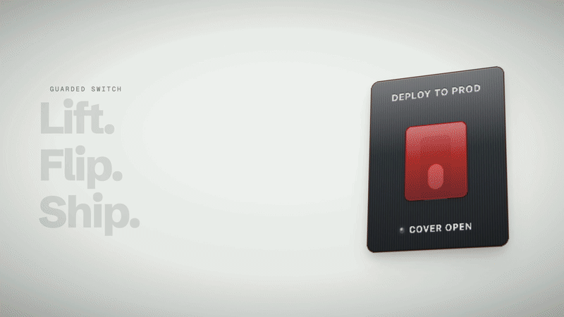
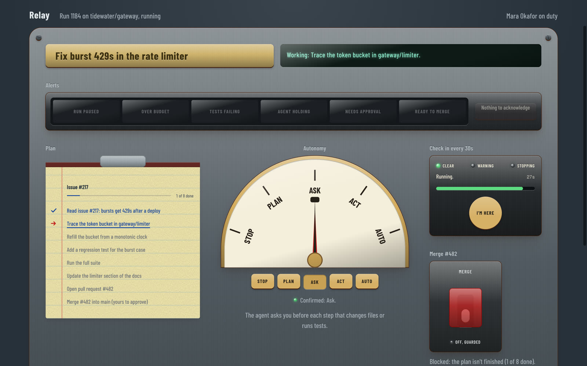
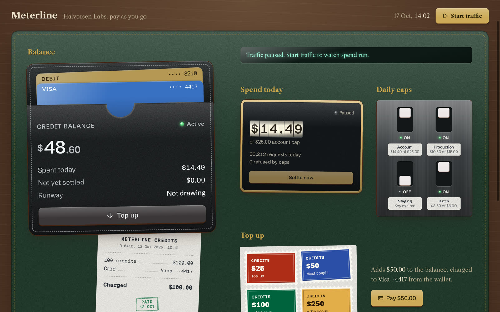
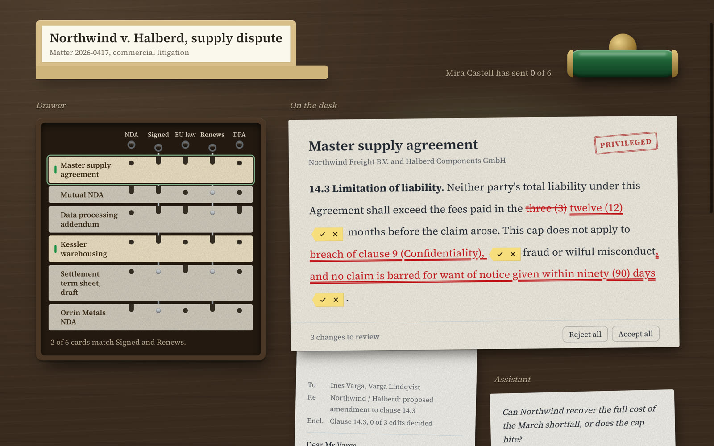

# Bevel

Tactile, skeuomorphic React components for real product work. Built on
[Base UI](https://base-ui.com) and Tailwind CSS v4, installed with the shadcn CLI.

**[bevel-ui.vercel.app](https://bevel-ui.vercel.app)**: docs, every component, and live demos.

<a href="https://bevel-ui.vercel.app"></a>

Each component is a physical object that does a real job in a modern app: a cover over a
deploy switch, alarm lamps that latch until someone sees them, a fader an agent can move and
you can take back, a library slip for an expiring API key. Like shadcn/ui, it isn't a
package: the source lands in your project and it's yours.

## Install

Add the registry to `components.json` once:

```json
{
  "registries": {
    "@bevel": "https://bevel-ui.vercel.app/r/{name}.json"
  }
}
```

Then add components by name:

```bash
npx shadcn@latest add @bevel/guarded-switch @bevel/annunciator
```

Or skip the setup and install straight from a URL:

```bash
npx shadcn@latest add https://bevel-ui.vercel.app/r/wallet.json
```

Every demo product also installs as a whole screen (a block) in a Next.js app:

```bash
npx shadcn@latest add @bevel/agent-console   # or billing-desk, release-hall, review-desk
```

You need React 19, Tailwind CSS v4 and a project set up with `npx shadcn@latest init`. See
the [installation guide](https://bevel-ui.vercel.app/docs/installation).

## What's inside

| Category | Components |
| --- | --- |
| Money | Wallet, Payment card, Amount, Meter, Receipt, Ticket sheet, Ledger, Keycard |
| Instruments | Number wheel, Gauge and dial, Breaker, Engine telegraph, Annunciator, Detent knob, Push to talk, Motorized fader, Mixer strip |
| Coordination | Guarded switch, Dead man's switch, Lockout, Take a number |
| Records | Keysort filter, Visible file, Contact sheet, Split-flap board, Due-date slip |
| Agents | Name tag, Task plan, Activity log, Approval, Delegation board |
| Documents | Citation, Redline |
| Marks | Stamp and seal, Redaction |

## Demos

Four made-up products, each one screen built from Bevel components. Every demo also
installs as a whole screen, e.g. `npx shadcn@latest add @bevel/agent-console`.

| | |
| --- | --- |
| [](https://bevel-ui.vercel.app/demo/1) | [](https://bevel-ui.vercel.app/demo/2) |
| **Relay**, an agent control room · `@bevel/agent-console` | **Meterline**, usage billing · `@bevel/billing-desk` |
| [](https://bevel-ui.vercel.app/demo/3) | [](https://bevel-ui.vercel.app/demo/4) |
| **Shipyard**, release coordination · `@bevel/release-hall` | **Casefile**, a legal review desk · `@bevel/review-desk` |

## Where they come from

Every component is modelled on a real object, and cites where that object came from. Patent numbers link to the patents themselves.

| Component | Source | Reference | Who, when |
| --- | --- | --- | --- |
| [Payment card](https://bevel-ui.vercel.app/components/wallet/payment-card) | Patent | [US 3,971,916](https://patents.google.com/patent/US3971916A/en), Methods of data storage and data storage systems | Roland Moreno, 1976 |
| [Number wheel](https://bevel-ui.vercel.app/components/number-wheel) | Patent | [US 548,482](https://patents.google.com/patent/US548482A/en), Cyclometer | Curtis H. Veeder, 1895 |
| [Meter](https://bevel-ui.vercel.app/components/meter) | Patent | [US 710,997](https://patents.google.com/patent/US710997A/en), Postage-stamp device | Arthur H. Pitney, 1902 |
| [Stamp and seal](https://bevel-ui.vercel.app/components/stamp) | History | [Encyclopedia.com, “Rubber Stamp”](https://www.encyclopedia.com/manufacturing/news-wires-white-papers-and-books/rubber-stamp) | Disputed: James Orton Woodruff or L. F. Witherell, 1866 |
| [Receipt](https://bevel-ui.vercel.app/components/receipt) | Patent | [US 221,360](https://patents.google.com/patent/US221360A/en), Improvement in Cash Register and Indicator | James and John Ritty, 1879 |
| [Ticket sheet](https://bevel-ui.vercel.app/components/ticket-sheet) | History | [Grace's Guide, Henry Archer](https://www.gracesguide.co.uk/Henry_Archer_(1799-1863)) | Henry Archer, 1848 |
| [Gauge and dial](https://bevel-ui.vercel.app/components/dial) | Patent | [US 9,163](https://patents.google.com/patent/US9163A/en), Pressure Gage | Eugène Bourdon, 1852 |
| [Breaker](https://bevel-ui.vercel.app/components/breaker) | Patent | [DE 458,392](https://patents.google.com/patent/DE458392C/de), Elektromagnetischer Überstromschalter | Stotz-Kontakt (credited to Hugo Stotz and Heinrich Schachtner), 1924 |
| [Ledger](https://bevel-ui.vercel.app/components/ledger) | History | [Library of Congress, History of Accounting](https://guides.loc.gov/history-of-accounting/practice/early-history) | Luca Pacioli, 1494 |
| [Keycard](https://bevel-ui.vercel.app/components/keycard) | A VingCard patent | [US 4,149,394](https://patents.google.com/patent/US4149394A/en), Lock arrangement employing mechanically acting code card and key card | Tor Sørnes, 1979 |
| [Name tag](https://bevel-ui.vercel.app/components/name-tag) | History | [Wikipedia, “Nametag”](https://en.wikipedia.org/wiki/Nametag) | C-Line Products, 1959 |
| [Task plan](https://bevel-ui.vercel.app/components/task-plan) | History | [Wikipedia, “Ampad”](https://en.wikipedia.org/wiki/Ampad) | Thomas W. Holley, 1888 |
| [Approval](https://bevel-ui.vercel.app/components/approval) | Patent | [US 3,127](https://patents.google.com/patent/US3127A/en), Notarial Seal | John Fraser, 1843 |
| [Delegation board](https://bevel-ui.vercel.app/components/delegation-board) | Patent | [US 155,604](https://patents.google.com/patent/US155604A/en), Improvement in Secretaries | William S. Wooton, 1874 |
| [Redline](https://bevel-ui.vercel.app/components/redline) | History | [Jacques André, Cahiers GUTenberg 31](https://numdam.org/item/CG_1998___31_45_0/) | Jacques André, 1998 |
| [Redaction](https://bevel-ui.vercel.app/components/redaction) | History | [Wikipedia, “Sanitization (classified information)”](https://en.wikipedia.org/wiki/Sanitization_(classified_information)) | Government document practice |
| [Guarded switch](https://bevel-ui.vercel.app/components/guarded-switch) | Patent | [US 11,548,656](https://patents.google.com/patent/US11548656B2/en), Virtual guarded switch | Sarah Barber and Felix B. Turcios (Rockwell Collins), 2023 |
| [Dead man's switch](https://bevel-ui.vercel.app/components/vigilance) | Patent | [US 4,525,011](https://patents.google.com/patent/US4525011A/en), Vigilance safety control system | Richard L. Wilson (American Standard), 1985 |
| [Lockout](https://bevel-ui.vercel.app/components/lockout) | An early patent | [US 4,864,834](https://patents.google.com/patent/US4864834A/en), Safety lock | Ronald Waite, 1989 |
| [Take a number](https://bevel-ui.vercel.app/components/take-a-number) | Patent | [US 3,885,724](https://patents.google.com/patent/US3885724A/en), Device for tearing off pieces of a certain length from a strip | Åke Ehrlund, 1975 |
| [Engine telegraph](https://bevel-ui.vercel.app/components/engine-telegraph) | History | [Science Museum Group, Chadburn's telegraph](https://collection.sciencemuseumgroup.org.uk/people/cp137369) | William Chadburn, 1870 |
| [Annunciator](https://bevel-ui.vercel.app/components/annunciator) | Standard | [ISA-18.1](https://www.isa.org/intech-home/2022/april-2022/departments/revision-of-annunciator-sequences-and-specificatio) | Instrument Society of America, 1979 |
| [Detent knob](https://bevel-ui.vercel.app/components/detent-knob) | An early patent | [US 3,260,805](https://patents.google.com/patent/US3260805A/en), Rotary switch with detent | George E. Pihl, 1966 |
| [Push to talk](https://bevel-ui.vercel.app/components/push-to-talk) | History | [IEEE Spectrum, the SCR-536 Handie-Talkie](https://spectrum.ieee.org/the-scr536-handietalkie-was-the-modern-walkietalkies-finicky-ancestor) | Galvin Manufacturing (later Motorola), 1942 |
| [Motorized fader](https://bevel-ui.vercel.app/components/mixer-strip/motorized-fader) | Patent | [US 5,122,720](https://patents.google.com/patent/US5122720A/en), Automated fader system | Joseph Martinson and Dale Manquen (Martinsound), 1992 |
| [Mixer strip](https://bevel-ui.vercel.app/components/mixer-strip) | History | [Universal Audio, the 610 console](https://www.uaudio.com/blogs/ua/ua-610-the-console-that-changed-recording-forever) | Bill Putnam Sr., 1960 |
| [Keysort filter](https://bevel-ui.vercel.app/components/keysort-filter) | Patent | [US 1,544,172](https://patents.google.com/patent/US1544172A/en), Sorting and classifying of flat sheets, tallies, cards, or the like | Alfred Perkins, 1925 |
| [Visible file](https://bevel-ui.vercel.app/components/visible-file) | Patent | [US 1,142,728](https://patents.google.com/patent/US1142728A/en), Card-index system | James H. Rand Jr., 1915 |
| [Contact sheet](https://bevel-ui.vercel.app/components/contact-sheet) | History | [Cleveland Museum of Art](https://www.clevelandart.org/exhibitions/proof-photography-era-contact-sheet) | Photographic practice |
| [Split-flap board](https://bevel-ui.vercel.app/components/split-flap) | Patent | [US 3,190,020](https://patents.google.com/patent/US3190020A/en), System for providing lines and boards of information showing symbols forming numbers, letters or other characters | Fermo Solari (Solari, Udine), 1965 |
| [Due-date slip](https://bevel-ui.vercel.app/components/due-date-slip) | History | [American Library Association, “History of Library Cards”](https://libguides.ala.org/librarycards/history) | Newark Public Library |

Components with no defining invention (the wallet, the amount, the citation sticker, the activity log) are left out rather than given a forced citation.

## Principles

- **A real job first.** If a plain control does the job as well, it isn't in Bevel.
- **Composable parts**, never mega-props. A part that works alone is its own component.
- **Tokens, not values.** Components read one foundation stylesheet; a lint fails on raw
  colours, durations or lengths.
- **One light, from above**, so every highlight and shadow agrees.
- **State in words.** What an object shows with light or position, it also says in text.
- **Compositor-only motion.** Transform, opacity and filter; never layout.

Read more in the [design system](https://bevel-ui.vercel.app/docs/design-system) and
[accessibility](https://bevel-ui.vercel.app/docs/accessibility) guides.

## Repository

```
packages/ui      the components and their stylesheets (what ships)
apps/web         docs site; also serves the registry at /r/{name}.json
apps/storybook   stories, run as browser tests with axe checks
scripts          registry build and the token lint
```

```bash
pnpm install
pnpm dev                          # docs site on :3000
pnpm storybook                    # Storybook on :6006
pnpm --filter storybook test      # every story as a browser test
pnpm check:tokens                 # design-system lint
```

## Contributing

Issues and pull requests are welcome. Please read [CONTRIBUTING.md](CONTRIBUTING.md) first.
New components especially need a clear job that no existing component already does.

## Author

Made by [@_hiteshbandhu](https://x.com/_hiteshbandhu) on X.

## License

[MIT](LICENSE). `docs/reference/components-build` is a copy of the components.build spec
under Apache 2.0; see its own license.
